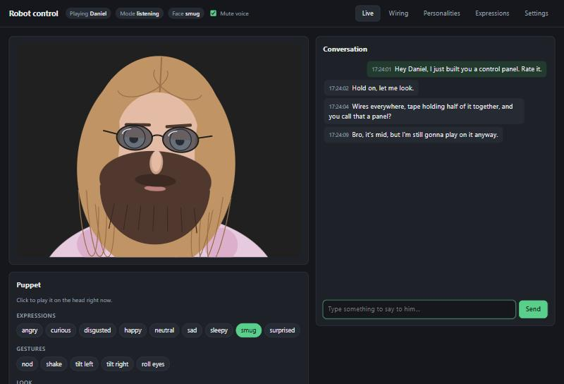
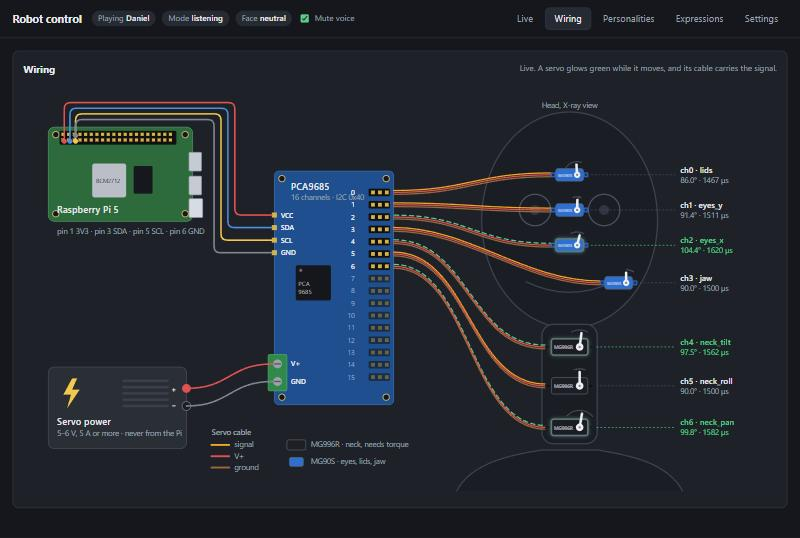

# robot-head

A prototype brain for an LLM-driven animatronic head. It listens through your microphone, sees through your webcam, answers with a voice, and moves a head. For now the head is a cartoon in the browser-based control panel; later it can drive real servos on a Raspberry Pi without any code changes.

Its character is just a system prompt: write your own personalities in the control panel and switch between them at any time.



The **Wiring** tab shows the real build, live: the Raspberry Pi, the PCA9685 servo board, the servo power supply, and every servo where it sits in the head, with its channel, angle and pulse width. Servos glow green while they move.



Everything runs on your computer except the language model, which you reach through [OpenRouter](https://openrouter.ai).

## Quick start

You need Python 3.10+ and [uv](https://docs.astral.sh/uv/).

```bash
cd robot-head
uv sync
cp .env.example .env        # then put your OpenRouter key in .env
```

Pick your microphone, speaker and camera. Each choice gets a quick check (a level meter, a chime, a camera preview) and is saved to `.env`:

```bash
uv run python -m robot_head --choose-devices
```

Try it by typing first, then by talking:

```bash
uv run python -m robot_head --text
```

```bash
uv run python -m robot_head
```

At startup it prints which speaker, microphone and camera it is using, and the address of the control panel. The first run downloads the Kokoro voice model (about 350 MB), the Parakeet speech recognition model (about 650 MB) and the face detector (230 KB). Press Ctrl+C in the terminal to quit. `--no-camera` and `--no-web` turn those parts off, and `--mute` starts with the voice muted. Run with `--help` to see every option.

## Control panel

While it runs, open **http://127.0.0.1:8765** in a browser:

- **Live**: the head itself, moving in real time, with the camera's view in the corner (the tracked face is boxed in green). Next to it: everything it hears and says, a box to type to it (handy for testing a prompt without talking), a mute switch, and puppet buttons that play any expression, gesture or glance on the head right away.
- **Wiring**: how the real build is hooked up, animated live. It shows Raspberry Pi pins 1, 3, 5 and 6 going to the PCA9685, the separate servo power supply, and each servo where it sits in the head (lids above the eyes, the eye servos between them, the jaw at its hinge, the three neck servos stacked in the neck). Each servo shows its channel, model, live angle and pulse width, and its arm turns as it moves. Below the diagram you calibrate each servo's channel and safe range, moving it live (see *Running on a Raspberry Pi*).
- **Personalities**: create, edit, duplicate and delete characters, and switch between them instantly. Each one has a name, the name it answers to, a voice and speed (empty uses the defaults from Settings), and its system prompt. They're stored in `robot.db`. The first one is imported from `personality.md`, and a second example comes along.
- **Expressions**: every facial expression is a set of five values: eyelid openness, chin tilt, head lean, and where the eyes drift sideways and up or down. Drag a slider and the head shows the result live; save to keep it. Add your own, and they become cues the LLM can use.
- **Memory**: everyone it has met, closest match first, with a dot on whoever is in view right now. Pick someone to see what it remembers about them: facts, preferences, habits, plans, and one-line summaries of past conversations. Edit or delete any memory, or add your own; memories you wrote or edited are never changed by the model. Name a person, merge two entries that turned out to be the same person, or forget someone completely (face, memories and journal). **Think it over** turns everything since the last time into memories right away instead of waiting.
- **Settings**: everything from `.env`, grouped and explained. Most changes apply immediately; the ones marked *restart* (devices, recognition and voice engines, motors) take effect after a restart, which **Save and restart** does in one go.
- **Pause** (in the header): puts it to sleep, head down and eyes nearly shut. It stops talking at once and hears, answers, watches and remarks on nothing until you click **Resume**. Messages typed meanwhile are shown as ignored. The header also shows who it recognizes in front of it.
- **Restart** (in the header, and in the banner that lists settings waiting for one): starts the robot afresh in about three seconds. It re-reads `.env`, reopens every device, and runs any new code after a `git pull`. Click twice to confirm; the page reloads by itself when the robot is back.

The panel only listens on this computer by default, because the settings include your API key. Set `WEB_HOST=0.0.0.0` to reach it from your phone, but only on a network you trust.

## Talking to it

- **Say its name to get its attention**, like "Hey Robo, what do you think of my setup?". Anything said without the name is ignored, and the console shows it as `(not talking to me: …)`. Each personality has its own name; leave it empty to have it answer everything.
- **Then just keep talking.** After it answers, it listens without the name for `FOLLOW_UP_SECONDS` (20 s). Its eyelids droop when it stops paying attention.
- **Interrupt it any time.** Talk over it for about a third of a second and it stops mid-sentence and listens. Its own voice is removed from the microphone with WebRTC echo cancellation (the same one browsers use for video calls), so this works through speakers, not just headphones.
- **It speaks up unprompted.** If it can see you and nobody has said anything for `REMARK_AFTER_SECONDS` (45 s), it comments on whatever you're doing. Each time you ignore it, it waits twice as long before the next one.
- **It watches what you do and recommends things.** Every 30 seconds it takes 9 frames spread over that time, puts them side by side in one picture so the model sees an action rather than a pose, and asks what you're doing ("eating chips while scrolling on a phone"). That builds a timeline, shown under *Seen lately* on the Live tab, which goes into every conversation. When you start something new, or keep doing one thing for 20 minutes, it gives you one concrete recommendation that fits, at most every 5 minutes and only once nobody has talked for 10 seconds. If the picture hasn't changed it doesn't ask the model again, so an empty or still room costs nothing. Every number, a separate model for watching, and what kind of things to recommend are under *Settings → Watching*, and all of them apply live.
- **It remembers you, and tells people apart.** It recognizes faces (OpenCV's SFace model, which turns a face into 128 numbers), so it knows whether it's talking to you or your roommate, and meets someone new only after seeing an unknown face three looks in a row. Tell it your name and it ties the name to your face. Everything said and seen goes into a journal; a minute after a conversation ends it thinks it over with one LLM call per person and keeps what is worth knowing weeks later ("Has a LAN party on Sat 7 Nov", "Usually plays guitar after dinner"), corrects what changed, and forgets what was wrong. What it remembers about whoever is in front of it goes into every reply, along with summaries of your last five conversations. Settings are under *Settings → Memory*.

## How it works

The head has two layers, because an LLM is far too slow to steer motors directly:

```
 microphone ──► audio.py (echo cancelling, speech detection) ──► ears.py (Parakeet) ──────┐
 speaker ◄──── audio.py ◄── voice.py (Kokoro or Piper TTS)                                 │
                                                     conversation.py (name, follow-ups, ◄──┘
                                                     interruptions, unprompted remarks)
                                                                    │
 webcam ──► camera.py ── snapshot with every message ──► brain.py (OpenRouter LLM)
               │                                            │ streamed reply with [cues]
               │ face position, 30x a second                ▼
               │                                   cues.py splits sentences and cues
               ▼                                     │                │
         reflexes.py  ◄───── cues, jaw level ────────┤                ▼
   (gaze, blinking, breathing,                        └──────── voice.py (Piper TTS)
    gestures, jaw smoothing)
               │ pose: 7 joints, normalized
               ▼
         motors.py ──► PCA9685 servos (or nothing, when simulated)
               └─────► wiring.py ──► control panel: face and wiring views (web.py, web/index.html)
```

- **Reflex layer** (`reflexes.py`): runs 30 times a second without asking the LLM. It follows your face (eyes jump first, then the neck catches up), glances around when nobody is there, blinks, breathes, looks up while "thinking", and opens the jaw in time with the speech audio.
- **Brain** (`brain.py`): one streamed LLM call per turn. The current camera frame is attached to your message, which is how the head "sees". The model moves the head by writing cues inside its reply, such as `[surprised] Oh, is that a cat? [tilt_left] What's its name?`. Each cue fires when its sentence starts playing, so the gesture lands on the right words, and nothing waits for a second LLM round trip.
- **Memory** (`people.py`, `memory.py`): once a second, the faces the camera found are matched against everyone it knows. Each person keeps up to 12 face fingerprints from different angles and light. What is said and seen is written to a journal tagged with the closest person, and thought over into memories in `robot.db`.
- **Speaking** starts as soon as the first sentence (or a long enough opening clause) has arrived, while the rest is still streaming in. Each next sentence's audio is generated in the background while the current one plays, so there are no gaps between sentences.

Cues the model can use:

| Kind | Cues |
|---|---|
| Expressions | `[neutral]` `[happy]` `[surprised]` `[sleepy]` `[angry]` `[sad]` `[curious]` `[smug]`, plus any you or the model add |
| Gestures | `[nod]` `[shake]` `[tilt_left]` `[tilt_right]` `[roll_eyes]` |
| Gaze | `[look_left]` `[look_right]` `[look_up]` `[look_down]` `[look_at_you]` |

## Make it yours

- **Character**: write and switch personalities in the control panel. The prompt you write comes first in the system prompt; the rules for speaking aloud, the camera and the cues are added after it automatically. `personality.md` is only read once, to create the first personality.
- **Expressions**: when no expression fits, the model invents one mid-sentence, like `[disgusted lids=0.3 tilt=0.1 roll=-0.2 look=0,-0.3]`. It plays right away, is saved (marked *llm* in the panel), and works as `[disgusted]` from then on. It never overwrites expressions you made or edited, and it can keep at most 40 of its own.
- **Look**: the face and the wiring diagram are drawn in the browser, in `robot_head/web/index.html` (`faceSVG` and the Wiring section). The face's colors are in `C` and `LENS_TINT` sets how dark the glasses are; `SPOTS` places each servo in the head on the diagram.
- **Model**: any OpenRouter model that accepts images works; set `OPENROUTER_MODEL` in `.env`. Every reply prints `[brain] first words after …s`, so you can compare how quickly models respond. `REASONING_EFFORT=none` (the default) keeps replies quick: with Haiku 5.5 and a camera frame it started talking after about 1 s, while `low` took 3–6 s. Models that always think, like the Gemini Flash family, need `low` instead.
- **Voice**: [Kokoro](https://huggingface.co/hexgrad/Kokoro-82M) is the default engine. It runs locally and sounds far more natural than Piper. Pick a voice with `TTS_VOICE` (`--list-voices` lists them; male ones start with `am_` for American or `bm_` for British) and set the pace with `TTS_SPEED`. `TTS_ENGINE=piper` switches to the lighter Piper voices.
- **Speech recognition**: [NVIDIA Parakeet](https://huggingface.co/nvidia/parakeet-tdt-0.6b-v3) runs locally. On a Ryzen 5 5600X it transcribes a phrase in about 0.25 s, as accurately as Whisper models eight times slower. `STT_ENGINE=whisper` switches to Whisper for languages Parakeet doesn't know; set `STT_LANGUAGE` with it, or Whisper guesses the language on every phrase.
- **Language**: Parakeet understands 25 European languages, German included, without any setting. For a German voice, set `TTS_ENGINE=piper` and `TTS_VOICE=de_DE-thorsten-medium` (Kokoro has no German). The model answers in the language you speak.

All settings are in `.env.example` with a comment each.

## Running on a Raspberry Pi

The rest of the code only ever sees a pose: seven joints with normalized values (`motors.py`). Moving from the simulation to real servos is a settings change, and the control panel keeps showing the face and the wiring either way.

### What you need

- Raspberry Pi 5 with 4 GB, its 27 W power supply, the Active Cooler, and a 32 GB microSD card
- A USB webcam (one with a built-in microphone saves buying a microphone) and a USB speaker, or a USB sound card with a small speaker. The Pi 5 has no headphone jack.
- A PCA9685 16-channel servo board, 3 MG996R servos for the neck and 4 MG90S servos for the lids, eyes and jaw
- A separate 5 V power supply of 10 A for the servos, a 1000 µF capacitor across its output, and servo extension cables

### Wiring

The Wiring tab shows exactly this hookup, so you can use it as your reference while building.

1. PCA9685 to the Pi: pin 1 (3V3) to VCC, pin 3 (SDA) to SDA, pin 5 (SCL) to SCL, pin 6 (GND) to GND.
2. The servo supply goes into the board's V+ screw terminal, never into the Pi. The grounds are shared through the board.
3. Servos on channels numbered from the top of the head down, so the cables don't cross: `lids` 0, `eyes_y` 1, `eyes_x` 2, `jaw` 3 (MG90S), `neck_tilt` 4, `neck_roll` 5, `neck_pan` 6 (MG996R, which have the torque for a head). Rest the head on a turntable bearing rather than on the pan servo's shaft.
4. Mount the camera on the body or base, not inside the moving head. Face tracking treats the camera image as fixed directions in the room.

Open-source eye mechanisms that use small servos, such as Will Cogley's 3D-printed design, fit this layout. Leave out joints your mechanism doesn't have by removing them from `JOINTS` in `motors.py`.

### Installing

1. With [Raspberry Pi Imager](https://www.raspberrypi.com/software/), put **Raspberry Pi OS Lite (64-bit)** on the card. In its settings, set the hostname to `robot-head`, a user name and password, your Wi-Fi, and turn on SSH.
2. Plug in the webcam and the speaker, start the Pi and log in from your PC: `ssh you@robot-head.local`
3. Get the code and run the installer:

   ```bash
   git clone https://github.com/sebh96/robot-head.git
   cd robot-head
   bash pi/install.sh
   ```

   It installs what's needed, turns on I2C, sets the Piper voice and real servos (Kokoro is too slow on a Pi), points the sound at your USB speaker and microphone, and sets the robot to start on every boot. It asks whether to open the control panel to your home network. Say yes only on a network you trust, because the panel shows your API key. Otherwise it prints an SSH command that brings the panel to your PC.
4. `sudo reboot`. The first start downloads the speech models (about 1 GB), so give it a few minutes.
5. Open the control panel, at `http://robot-head.local:8765` or through the SSH command the installer printed, and paste your OpenRouter key under Settings.
6. **Calibrate every servo before attaching any linkage**: in the Wiring tab, pick a servo, drag **Try** slowly to the first end the mechanism may reach and click **Set** under Start, then do the same for the other end. **Test** sweeps between the two; **Save** keeps it. The defaults are placeholders. A servo that turns the wrong way just gets its Start and End the other way round.

To keep your personalities, expressions and memories, copy `robot.db` from the PC into the robot-head folder on the Pi while the robot is stopped. A personality with a Kokoro voice talks with Piper's default voice there until you pick a Piper one.

Everyday commands on the Pi:

- See what it's doing: `journalctl -u robot-head -f`
- Stop or start it: `sudo systemctl stop robot-head`, `sudo systemctl start robot-head`
- Pick another camera (stop it first): `uv run python -m robot_head --choose-devices`
- Update: `git pull && uv sync --frozen --extra pi`, then **Restart** in the control panel
- After plugging in other sound devices, run `bash pi/install.sh` again.

## Known limits and next steps

- **Not yet run on a real Raspberry Pi.** Every package has a ready-made build for it, and the installer and the servo driver are tested against stand-ins, but how fast speech recognition runs on a Pi 5 hasn't been measured.
- **Interrupting is tuned on a simulated room.** In a real room with loud speakers it may need adjusting: if it cuts itself off, turn the volume down or set `BARGE_IN=false`.
- **Kokoro is slower than Piper.** On a Ryzen 5 5600X it generates speech about 3x faster than real time, so replies start roughly 1–1.5 s later than with Piper (about 2–3.5 s after you stop talking in total). Short replies keep this down. On a Raspberry Pi, use Piper.
- **Memory is tied to the closest face.** With two people in view, everything said goes to whoever is nearest. It recognizes faces at least 60 pixels wide, so at a few meters or in dim light it may not know who you are. Two entries for one person can happen after a big change of look or light; merge them in the Memory tab.
- **Short-term memory is the last 12 exchanges.** Older parts of a conversation reach it only as what it chose to remember.
- **Speech detection is simple.** It measures background noise at startup and then reacts to loudness. In a noisy room, raise `SILENCE_SECONDS` or use a directional microphone.
- **Name spotting runs speech recognition on everything it hears.** That's fine on a PC; on a Raspberry Pi, a dedicated wake-word model (like openWakeWord) would be lighter.

## Troubleshooting

| Problem | Fix |
|---|---|
| The head looks away from you instead of at you | `CAMERA_FLIP=true` |
| "Could not open camera", or the wrong camera | `--choose-devices`, or run with `--no-camera` |
| It never notices you speaking, or triggers on noise | Pick the right microphone with `--choose-devices`; stay quiet during the 1-second calibration at startup |
| No sound, or sound from the wrong device | Pick the speaker with `--choose-devices` |
| "No microphone matches …" after unplugging something | Plug it back in, or pick another with `--choose-devices` |
| It cuts you off mid-sentence | Raise `SILENCE_SECONDS` to 1.2 |
| It ignores you | Say its name; check the console's `(not talking to me: …)` lines to see what it heard |
| It interrupts itself, or prints `(my own voice came back: …)` a lot | Lower the speaker volume or move it away from the mic; `BARGE_IN=false` turns interrupting off |
| Wrong words get transcribed | Set `SAVE_RECORDINGS=true`, talk to it, and listen to the clips in `recordings/` next to `transcripts.txt`. Quiet or cut-off clips point at the microphone (pick another with `--choose-devices`, or move closer) or at `SILENCE_SECONDS` |

Run the tests with `uv run pytest`.
